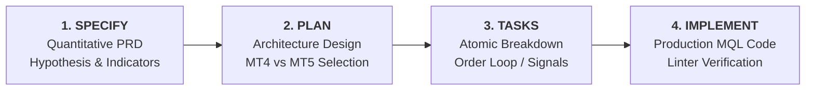

# Spec-Driven Development for Trading Systems

Write a structured, quantitative specification before writing any MQL4 or MQL5 code.
The strategy specification is the shared contract defining *what we are trading*, *why the edge exists*, *exact entry/exit triggers*, and *how risk is contained*.

---

## 1. The Gated Workflow for Quantitative EAs



---

## 2. Quantitative Strategy Specification Template

Every strategy specification document created under `docs/strategies/*.md` should follow this template:

```markdown
# Strategy Specification: [Strategy Name]

## 1. Executive Summary & Market Edge
- **Asset / Symbol**: XAUUSD (Gold)
- **Primary Timeframe**: M1 / M5 / M15 / H1
- **Trading Style**: Scalping / Day Trading / Swing
- **Market Inefficiency**: [What behavioral pattern or microstructure anomaly is exploited?]

## 2. Market Regime & Session Filters
- **Active Trading Hours**: London / New York Overlap (e.g. 12:00 - 18:00 GMT)
- **Blocked Sessions**: Asian Rollover (23:00 - 01:00 GMT)
- **Volatility Filter**: ATR(14) > threshold, ADX > 25

## 3. Indicator Configuration & Buffers
- **Indicator 1**: EMA(50) on Close price (Trend Filter)
- **Indicator 2**: RSI(14) with levels 30 / 70 (Momentum Trigger)
- **Math Formulas**: $RSI = 100 - \frac{100}{1 + RS}$

## 4. Entry Rules (Deterministic Logic)
- **Long Entry Conditions**:
  1. Price > EMA(50) on closed bar 1
  2. RSI(14) crosses above 30 from oversold
  3. Current Spread <= MaxAllowedSpreadPoints
- **Short Entry Conditions**:
  1. Price < EMA(50) on closed bar 1
  2. RSI(14) crosses below 70 from overbought
  3. Current Spread <= MaxAllowedSpreadPoints

## 5. Exit Rules & Trade Management
- **Initial Stop Loss**: $SL = 150$ points below entry (or $1.5 \times ATR$)
- **Take Profit**: $TP = 300$ points ($1:2$ Risk-Reward)
- **Trailing Stop**: Breakeven after $+100$ points profit; trailing step $= 50$ points

## 6. Risk Containment & Boundaries
- **Risk Per Trade**: $1.0\%$ of account equity
- **Max Open Positions**: 1
- **Max Orders Per Bar**: 1
- **Daily Drawdown Limit**: $5.0\%$ (Shutdown EA upon breach)
```
