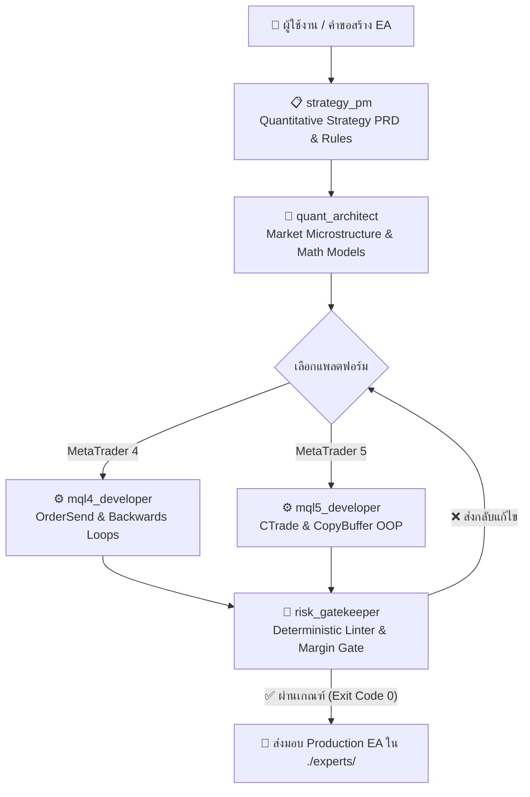

# 🪙 GoldTrader: Production Quantitative EA Development Harness (MT4 & MT5)

[-blue.svg)](https://www.mql4.com)
[-green.svg)](https://www.mql5.com)
[](docs/architecture/deterministic-harness.md)
[](docs/policies/unittest-policy.md)

ระบบ **Deterministic Multi-Agent Algorithmic Trading Harness** สำหรับการออกแบบ, พัฒนา, ตรวจสอบ (Audit), และเพิ่มประสิทธิภาพ Expert Advisors (EAs) บนคู่เงิน/สินทรัพย์ **XAUUSD (Gold)** รองรับทั้งแพลตฟอร์ม **MetaTrader 4 (MQL4)** และ **MetaTrader 5 (MQL5)** อย่างเต็มรูปแบบ

โปรเจกต์นี้ผสานรวม **Control Plane** แบบ Deterministic State Machine จาก `TeamAgents` พร้อมคัดเลือกและปรับแต่งทักษะเชิงลึก (Skills) จาก `antigravity-awesome-skills` และปฏิบัติตาม **Production Harness Master Standards (8 Golden Pillars)** อย่างเคร่งครัด

---

## 📌 จุดเด่นสำคัญ (Key Capabilities)

- **Dual-Engine MQL4 & MQL5 Architecture**:
  - **MT4 (MQL4)**: รองรับ Order pool, Backwards order loops (`OrdersTotal() - 1 down to 0`), Slippage handling, Error 130/138/146 retry loops พร้อม `RefreshRates()`, Legacy indicator shifts, และการคำนวณ Pip บนราคาทอง 2/3 ทศนิยม
  - **MT5 (MQL5)**: รองรับ Modern Object-Oriented Programming (OOP) ผ่าน `<Trade\Trade.mqh>`, `CTrade`, `CPositionInfo`, `CSymbolInfo`, การจัดการบัฟเฟอร์ด้วย `CopyBuffer()` และ `ArraySetAsSeries()`, ตลอดจนการปล่อยหน่วยความจำใน `OnDeinit()` ด้วย `IndicatorRelease()`
- **⚙️ Deterministic State Machine (Control Plane)**:
  - แยก Control Plane ออกจาก Data Plane ควบคุม Flow การทำงานระหว่างทีมอย่างแม่นยำ ไม่พึ่งพาการเดาของ LLM
  - บันทึก Task Call-Stack ลง `stack.json` ด้วยระบบ Atomic File Writing
- **⚡ Prompt on Demand Builder (JIT Context)**:
  - ประกอบ Prompt แบบ Just-In-Time โดยดึงเฉพาะ Persona + Top of Stack + Unified Git Diff + Allowed Files ป้องกันปัญหา Context Rot และ Token Bloat
- **🛡️ Built-in MQL Code Linter & Verification Gate**:
  - ตรวจสอบไวยากรณ์ (Syntax), การจับคู่ปีกกา `{}` / วงเล็บ `()`, และ **กฎเหล็กการใส่วงเล็บสำหรับตัวดำเนินการตรรกะ `((a && b) || c)`** อัตโนมัติ
  - ป้องกันการใช้ฟังก์ชันข้ามแพลตฟอร์ม (ห้ามใช้ `CTrade` ใน MT4, ห้ามใช้ `OrderSend` เก่าใน MT5)
- **⚡ Strict Token Optimization & Test Control (Zero-Test by Default)**:
  - ค่าเริ่มต้นทำงานในโหมด **Implementation-Only Mode** 100% มุ่งเน้นการสร้างโค้ดและสัญญา (Contract)
  - เข้าสู่ Testing Mode เฉพาะเมื่อผู้ใช้สั่งการอย่างชัดเจน (Opt-In Trigger) พร้อมจำกัดลูปแก้โค้ดสูงสุดไม่เกิน 2 ครั้ง (Max 2 Attempts)
- **🚀 Tier-0 Dual-Layer Caching Engine**:
  - L1 In-Memory LRU (`<0.2ms`) + L2 SQLite WAL with zlib compression (`<2.0ms`)
  - Auto-initialization อัตโนมัติใน `./cache/` ตั้งแต่การรันครั้งแรก
- **🚨 Emergency & Red Flag Interceptors**:
  - ตรวจจับความเสี่ยงวิกฤต: Margin Level $< 150\%$ / $< 100\%$, Daily Drawdown $\ge 5\%$, และ Spread Widening $> 40$ points บน XAUUSD

---

## 🔄 แผนภาพการทำงานร่วมกันของทีมพัฒนา (SDLC Flow)



---

## 👥 บทบาทและหน้าที่ภายในทีม (Team Roles)

| บทบาท (Role) | รหัส Agent | หน้าที่หลัก | ทักษะที่เกี่ยวข้อง (Skills) |
| :--- | :--- | :--- | :--- |
| **📋 Strategy Product Manager** | `strategy_pm` | แปลงโจทย์การเทรดเป็น Quantitative Strategy PRD, กำหนดเงื่อนไข Entry/Exit, ตัวกรองเวลา (Session Filter) | [trading-spec-driven](.agents/skills/trading-spec-driven/SKILL.md) |
| **📐 Quantitative Architect** | `quant_architect` | วิเคราะห์ Market Microstructure บน XAUUSD, คำนวณ Sharpe, Sortino, VaR, และ Expectancy ด้วยสูตร $\LaTeX$ | [quant-analyst](.agents/skills/quant-analyst/SKILL.md) |
| **⚙️ Senior MQL4 Developer** | `mql4_developer` | พัฒนา EA บน MT4, วนลูป Order ถอยหลัง, จัดการ Slippage, Requote, และ Error 130/138 Retry Loops | [mql4-ea-development](.agents/skills/mql4-ea-development/SKILL.md), [mql-clean-code-guard](.agents/skills/mql-clean-code-guard/SKILL.md) |
| **⚙️ Senior MQL5 Developer** | `mql5_developer` | พัฒนา EA บน MT5 แบบ OOP ด้วย `CTrade`, `CPositionInfo`, ดึงข้อมูลผ่าน `CopyBuffer`, จัดการทรัพยากรใน `OnDeinit()` | [mql5-ea-development](.agents/skills/mql5-ea-development/SKILL.md), [mql-clean-code-guard](.agents/skills/mql-clean-code-guard/SKILL.md) |
| **🧪 Risk Gatekeeper & QA** | `risk_gatekeeper` | ตรวจสอบโค้ดด้วย MQL Static Linter (Exit Code 0), บังคับใช้ Stop Loss, Dynamic Spread Check, คุมกฎ Zero-Test | [risk-manager](.agents/skills/risk-manager/SKILL.md), [anti-hallucination](.agents/skills/anti-hallucination-guardian/SKILL.md) |

---

## 💻 การใช้งาน Harness CLI (`harness/cli.py`)

คำสั่งสำหรับควบคุมและสั่งการระบบ Harness:

```bash
# 1. เริ่มต้น Task พัฒนา EA บน MT4 / MT5 ลงใน stack.json
python -m harness.cli init --task-id GOLD-001 --title "Build XAUUSD Scalper EA" --agent strategy_pm --allowed-files docs/strategies/xauusd-scalper.md

# 2. ตรวจสอบสถานะและงานบน Top of Stack
python -m harness.cli status

# 3. สร้าง Clean JIT Prompt on Demand สำหรับ Agent
python -m harness.cli build-prompt

# 4. ส่งผลงานแบบ Structured Output เพื่อเปลี่ยน State
python -m harness.cli transition --input '{"action": "pop_task", "status": "completed", "summary": "Done"}'

# 5. ตรวจสอบไวยากรณ์และกฎความปลอดภัยของโค้ด MQL4 / MQL5 ด้วย Linter
python -m harness.cli check-mql experts/mt4/GoldScalper_MT4.mq4 experts/mt5/GoldScalper_MT5.mq5

# 6. ตรวจสอบและซ่อมแซมแผนภาพ Mermaid ในเอกสาร Markdown
python -m harness.cli check-mermaid docs/architecture/deterministic-harness.md --fix

# 8. คอมไพล์โค้ด MQL4 / MQL5 แบบ Headless ผ่าน MetaEditor จริง (0 Errors, 0 Warnings)
python -m harness.cli compile-mql experts/mt4/GoldScalper_MT4.mq4 experts/mt5/GoldScalper_MT5.mq5

# 9. รันชุดทดสอบ Ground-Truth Benchmark 10 ข้อ พร้อมออกรายงานใน ./output/
python -m harness.cli eval-benchmark

# 10. ตรวจสอบหน้าต่าง Blackout ข่าวเศรษฐกิจสหรัฐฯ ระดับสูง (NFP, CPI, FOMC)
python -m harness.cli check-news --symbol XAUUSD
```

---

## 📁 โครงสร้างโปรเจกต์ (Project Blueprint)

```text
GoldTrader/
├── AGENTS.md                          # กฎการกำกับดูแลเอเจนต์, 8 เสาหลัก และนโยบาย Zero-Test
├── README.md                          # ภาพรวมสถาปัตยกรรมและการใช้งาน
├── .gitignore                         # กำหนดไฟล์ยกเว้นชั่วคราว แคช และไบนารี
│
├── harness/                           # 🛡️ เครื่องยนต์ Deterministic Harness
│   ├── __init__.py
│   ├── cli.py                         # เครื่องมือ CLI สำหรับควบคุมระบบ (รวม compile & eval)
│   ├── schemas.py                     # Data Schemas และ Structured Output Contracts
│   ├── state_machine.py               # Deterministic State Machine & Agent Routing
│   ├── task_stack.py                  # ระบบ Atomic Stack Management (stack.json)
│   ├── prompt_builder.py              # Prompt on Demand Builder (JIT Context Assembler)
│   ├── verifier.py                    # Deterministic Verifier & Headless MetaEditor Runner
│   ├── evaluator.py                   # 10-Case Ground Truth Benchmark Evaluator
│   ├── benchmark_cases.json           # สเปกชุดทดสอบเกณฑ์มาตรฐาน 10 ข้อ (TC-01 ถึง TC-10)
│   ├── news_filter.py                 # Macroeconomic High-Impact News Blackout Gate
│   ├── sanitizer.py                   # ตัวถอดรหัสและซ่อมแซม JSON ในเครื่อง (Zero Token Repair)
│   ├── git_diff.py                    # Git Unified Diff Extractor
│   ├── cache.py                       # Tier-0 Dual-Layer Cache (L1 LRU + L2 SQLite WAL)
│   ├── mermaid_guardian.py            # Mermaid Unicode Guardian & Auto-Healer
│   ├── document.py                    # Markdown-Native Clean Exporter (Chat-only PDF)
│   ├── interceptor.py                 # Emergency & Red Flag Risk Interceptor
│   ├── oracle.py                      # Grounding Whitelist Oracle (MQL APIs & Gold Specs)
│   └── test_guardian.py               # Strict Token Optimization & Test Policy Guardian
│
├── .agents/skills/                    # 🧠 ทักษะเฉพาะทางที่คัดเลือกและปรับแต่งแล้ว
│   ├── mql4-ea-development/           # สถาปัตยกรรม MT4, Order loops, Error 130/138, Slippage
│   ├── mql5-ea-development/           # สถาปัตยกรรม MT5 OOP, CTrade, CopyBuffer, OnTradeTransaction
│   ├── quant-analyst/                 # โมเดลคณิตศาสตร์, Sharpe, Sortino, VaR, Walk-Forward
│   ├── risk-manager/                  # Fixed Fractional, Half-Kelly, Margin & Drawdown Breakers
│   ├── mql-clean-code-guard/          # Clean Code, วงเล็บตรรกะ ((a && b) || c), Memory Safety
│   ├── trading-spec-driven/           # Quantitative Strategy PRD ก่อนเริ่มเขียนโค้ด
│   └── anti-hallucination-guardian/   # กฎเหล็กความจริงเชิงประจักษ์และการประหยัด Token
│
├── docs/                              # 📚 เอกสารสถาปัตยกรรมและนโยบาย
│   ├── architecture/
│   │   └── deterministic-harness.md   # สเปก Deterministic Harness เต็มรูปแบบ
│   ├── policies/
│   │   ├── unittest-policy.md         # นโยบายประหยัด Token (Zero-Test by Default)
│   │   └── mql-coding-standards.md    # มาตรฐานการเขียนโค้ด MQL4 และ MQL5
│   └── strategies/
│       └── xauusd-microstructure-spec.md # สเปก Market Microstructure สำหรับทองคำ (XAUUSD)
│
├── experts/                           # 🤖 ซอร์สโค้ด Expert Advisors ตัวอย่างระดับ Production
│   ├── mt4/
│   │   └── GoldScalper_MT4.mq4        # MT4 Scalper EA พร้อม Backwards Loop, Trailing, Breakeven
│   └── mt5/
│       └── GoldScalper_MT5.mq5        # MT5 Scalper EA แบบ OOP พร้อม CTrade, CopyBuffer, Trailing
│
├── include/                           # 📦 ไลบรารีส่วนขยาย
│   ├── mt4/
│   │   ├── TradeHelper_MT4.mqh        # ตัวคำนวณ Lot, Spread, Trailing Stop, Breakeven สำหรับ MT4
│   │   └── NewsFilter.mqh             # ตัวกรองข่าวเศรษฐกิจสหรัฐฯ สำหรับ MT4
│   └── mt5/
│       ├── TradeHelper_MT5.mqh        # คลาสคำนวณ Lot, Spread, Trailing Stop, Breakeven สำหรับ MT5
│       └── NewsFilter.mqh             # ตัวกรองข่าวเศรษฐกิจสหรัฐฯ สำหรับ MT5
│
├── output/                            # 📤 โฟลเดอร์ส่งออกรายงาน Clean Markdown (.md) UTF-8
└── cache/                             # 🗄️ ฐานข้อมูล SQLite Compressed Disk Cache
```

---

## 🛡️ กฎเหล็กการเขียนโค้ด MQL บน GoldTrader

1. **การใส่วงเล็บสำหรับตัวดำเนินการตรรกะ (Operator Precedence)**:
   - บังคับใส่วงเล็บ `()` ครอบคู่เงื่อนไขเสมอเมื่อใช้ `&&` ร่วมกับ `||`:
     `if((isTrendBullish && rsiOversold) || (breakoutBuy && volumeSurge))`
2. **การวนลูปออเดอร์ใน MT4 (Backwards Loop Invariant)**:
   - ต้องวนลูปถอยหลัง `for(int i = OrdersTotal() - 1; i >= 0; i--)` เพื่อป้องกันการข้าม Order Index เมื่อมีการปิดออเดอร์
3. **การคืนหน่วยความจำอินดิเคเตอร์ใน MT5 (Resource Cleanup Invariant)**:
   - ต้องเรียกใช้ `IndicatorRelease(handle)` ใน `OnDeinit()` สำหรับทุก Indicator Handle
4. **การคำนวณขนาด Lot ตามความเสี่ยง (Risk-Based Lot Sizing)**:
   - ห้ามใช้ Fixed Lot โดยไม่มีการคำนวณ Stop Loss distance และมูลค่า Tick Value ต่อบัญชี
