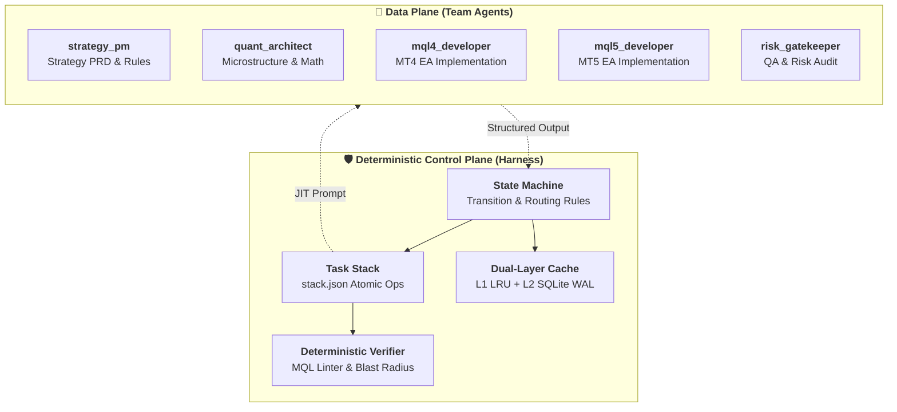

# 🏗️ GoldTrader Deterministic Multi-Agent Harness Architecture

This document specifies the deterministic state machine, call-stack architecture, prompt-on-demand engine, and production safety gates for the GoldTrader system.

---

## 1. System Architecture Overview

The GoldTrader harness strictly decouples the **Control Plane** (deterministic Python state engine) from the **Data Plane** (probabilistic LLM reasoning):

---

## 2. Team Roles & State Mapping

| Agent Role | System State | Focus Area | Standard Artifacts |
| :--- | :--- | :--- | :--- |
| `strategy_pm` | `STRATEGY_SPEC` | PRD, Hypothesis, Entry/Exit Rules | `docs/strategies/*.md` |
| `quant_architect` | `QUANT_MODELING` | Math models, Sharpe, Sortino, Slippage | `docs/strategies/*.md` |
| `mql4_developer` | `MT4_CODING` | MT4 EA, OrderSend loops, Error 130/138 retries | `experts/mt4/*.mq4`, `include/mt4/*.mqh` |
| `mql5_developer` | `MT5_CODING` | MT5 EA, CTrade, CopyBuffer, OnTradeTransaction | `experts/mt5/*.mq5`, `include/mt5/*.mqh` |
| `risk_gatekeeper` | `RISK_REVIEW` | Independent Verification, Risk & Linter Gate | `VerificationReceipt` |

---

## 3. Strict Mode Guardrails

1. **Hyper-Disciplined Stack Hygiene**: Agents may only touch files declared in `allowed_files`. Unauthorized modifications are immediately rejected.
2. **Atomic Decomposition**: Code changes must remain within $300$ lines per task frame. Larger features must be decomposed via `push_task`.
3. **Mandatory Verification before Pop**: No task can be popped from `stack.json` without an empirical verification pass (exit code 0 / MQL linter clean).
4. **Visual & Diagram Protocol**: Never use ASCII art/tables (`+----+`). Use Mermaid code blocks or Markdown tables.
5. **Zero Fluff & Extreme Brevity**: Strips conversational pleasantries and limits summary length to $250$ characters.
