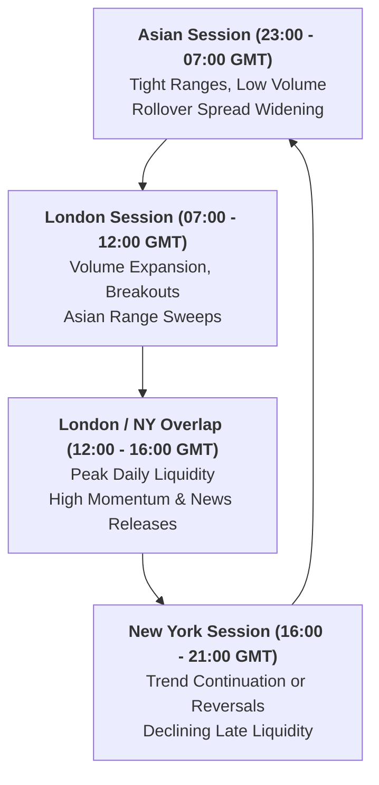

# 🪙 XAUUSD (Gold) Market Microstructure Specification

Analysis of Gold market behavior, liquidity regimes, session volatility, and execution risks.

---

## 1. Symbol & Contract Characteristics

- **Instrument**: XAUUSD (Spot Gold vs US Dollar)
- **Standard Lot Size**: $100$ Troy Ounces
- **Pip vs Point**:
  - 3-digit broker ($2650.505$): $1\text{ pip} = 10\text{ points} = 0.10\text{ USD}$
  - 2-digit broker ($2650.50$): $1\text{ pip} = 1\text{ point} = 0.10\text{ USD}$
- **Tick Value per 0.01 lot**: $\$0.10$ per pip movement

---

## 2. Liquidity Session Dynamics

---

## 3. High-Impact Volatility Drivers

1. **Macroeconomic News Releases**:
   - US Non-Farm Payrolls (NFP) - First Friday of each month.
   - US Consumer Price Index (CPI) and Producer Price Index (PPI).
   - FOMC Rate Decisions and Press Conferences.
2. **Execution Safeguards**:
   - Spread expansion filter: Skip new orders if spread $> 35$ points.
   - Slippage allowance: Expect $10 - 25$ points slippage during news spikes.
   - Max orders per bar: Enforce $\le 1$ order per bar to avoid rapid grid clustering during flash crashes.
