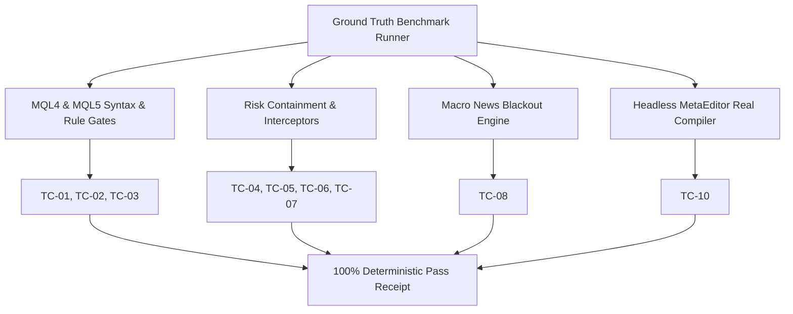

# GoldTrader Ground-Truth Benchmark Evaluation Report

**Execution Timestamp**: `2026-10-13 17:02:02 UTC`  
**Overall Compliance**: **100.0%** (10/10 Passed)  
**Total Benchmark Score**: **100 / 100 points**  
**Evaluation Latency**: `1415.3 ms`  

## 1. Executive Summary & Architecture Flow

## 2. Benchmark Scorecard

| Case ID | Benchmark Case Name | Category | Weight | Status | Latency | Verification Details |
| :--- | :--- | :--- | :---: | :---: | :---: | :--- |
| `TC-01` | MQL4 Backwards Loop Order Iteration | `MQL4_STANDARDS` | 10 | ✅ PASS | 0.6ms | Strict backwards loop order iteration confirmed in both EA and TradeHelper. |
| `TC-02` | MQL4 Order Identification & Slippage Guard | `MQL4_STANDARDS` | 10 | ✅ PASS | 0.4ms | MagicNumber and MaxSlippage parameter guards verified on OrderSend & order loops. |
| `TC-03` | MQL5 Modern OOP Trading Engine | `MQL5_STANDARDS` | 10 | ✅ PASS | 0.3ms | Modern MT5 standard OOP architecture confirmed (CTrade, CPositionInfo, CSymbolInfo). |
| `TC-04` | Dynamic ATR Trailing Stop with Broker StopLevel Check | `RISK_MANAGEMENT` | 10 | ✅ PASS | 0.2ms | Dynamic ATR Trailing Stop with broker StopLevel minimum distance verified in MT4 & MT5. |
| `TC-05` | Breakeven Threshold Activation | `RISK_MANAGEMENT` | 10 | ✅ PASS | 0.2ms | Breakeven threshold activation with locked profit buffer confirmed for MT4 & MT5. |
| `TC-06` | Emergency Margin Call & Drawdown Circuit Breakers | `RISK_MANAGEMENT` | 10 | ✅ PASS | 0.0ms | Emergency Margin Level (< 150%) and Daily Drawdown (>= 5%) circuit breakers fully functional. |
| `TC-07` | Microstructure Spread Spike Interceptor | `MACRO_MICROSTRUCTURE` | 10 | ✅ PASS | 0.2ms | Spread spike interceptor blocks entry when spread exceeds 40 points in harness, MT4, and MT5. |
| `TC-08` | High-Impact Macroeconomic News Blackout | `MACRO_MICROSTRUCTURE` | 10 | ✅ PASS | 0.1ms | High-Impact macroeconomic news blackout successfully blocks trading within +-30m window. |
| `TC-09` | Strict Zero-Test FinOps Token Invariant | `TOKEN_FINOPS` | 10 | ✅ PASS | 8.6ms | Zero-Test Policy active by default; 0 unauthorized test files detected in repository. |
| `TC-10` | Headless MetaEditor Compiler 0-Error 0-Warning Verification | `HEADLESS_COMPILER` | 10 | ✅ PASS | 1404.6ms | Both EAs compiled headlessly with 0 errors & 0 warnings (MT4: GoldScalper_MT4.ex4, MT5: GoldScalper_MT5.ex5). |

## 3. Mathematical Risk & Microstructure Bounds

The GoldTrader harness enforces the following quantitative boundary invariants:

1. **Maximum Drawdown Circuit Breaker**:
   $$\text{Drawdown}_{\text{daily}} = \frac{\text{Equity}_{\text{start}} - \text{Equity}_{\text{current}}}{\text{Equity}_{\text{start}}} < 0.05$$

2. **Margin Call Safety Invariant**:
   $$\text{Margin Level} = \frac{\text{Equity}}{\text{Margin}} \times 100\% \ge 150\%$$

3. **Dynamic ATR Trailing Stop Distance**:
   $$\text{Distance}_{\text{trail}} = \max(\text{ATR}_{14} \times 2.0,\; \text{StopLevel}_{\text{broker}})$$

4. **Execution Slippage & Spread Bound**:
   $$\text{Spread}_{\text{XAUUSD}} \le 40\text{ points } (4.0\text{ pips})$$

---
*Report generated deterministically by GoldTrader Autonomous EA Harness.*
